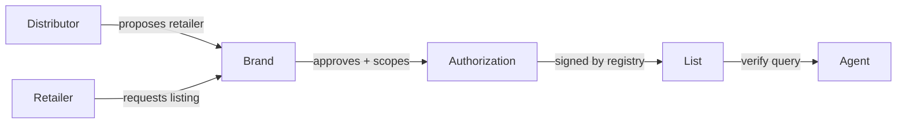

# Authorized Retailers Specification v0.4

Draft v0.4 · unreleased  
Editor: authorizedretailers.ai

Licensed under [CC BY 4.0](https://creativecommons.org/licenses/by/4.0/). JSON Schemas and reference code: Apache-2.0.

## 1. Overview and scope

This spec defines how a brand records which retailers it has authorized to sell its products, and how an AI shopping agent verifies that status before recommending or buying. It is an open format with a single registry: anyone may read, cache or relay what the registry publishes, and anyone may build software on the format, but authorizedretailers.ai is the only registry. A list or answer counts only if it verifies against the registry's published key set (section 8).

The registry works like a notary. It checks that a brand controls its domain and is independently linked to it (section 4), records the brand's own decisions and signs them. The signature says who published a list, not who is authorized. Only the brand decides that (section 3).

Status: draft v0.4, for discussion with brands, retailers and agent developers. Breaking changes are expected before v1.0. Changes are listed in section 14.

The spec asserts one thing: whether a brand has authorized a given seller, on a given channel, in a given territory, for a given product, as of a given date.

Scope: the spec covers consumer-facing online channels: marketplaces and web stores. Every channel is identified by a domain, because agents buy from domains. Physical storefronts are not channels: an omnichannel retailer is listed by its web domain. Trade, wholesale and practitioner-only channels are out of scope. Sellers there are not listed, so their resale on consumer channels verifies as unlisted. Purchases across borders (for example on amazon.com for delivery to Canada) are out of scope for v0.4.

It does not assert:

- **Authenticity.** An authorized seller can still sell counterfeit goods or have its account compromised. Authorization and authenticity are separate questions.
- **Pricing.** The format carries no price, MAP or discount terms.
- **Legal status.** A seller not listed is unlisted, not unlawful. A seller the brand declares unauthorized (section 3.2) is one the brand says it has not authorized: that is the brand's statement, not a finding by the registry that the seller acts unlawfully or sells counterfeit goods. How an agent or platform acts on either result is its own decision.

The key words MUST, SHOULD and MAY are used as defined in RFC 2119.

## 2. Terminology

| Term | Meaning |
| --- | --- |
| Brand | The owner of a trademark whose products are sold, identified by one or more verified domains. |
| Retailer | Any seller authorized to sell the brand's products: a marketplace seller or a web store. |
| Distributor | A party that supplies retailers. A distributor MAY propose retailers to a brand that has designated it, but cannot authorize them. |
| Authorization | A brand's statement that a retailer may sell within a stated scope, until the brand revokes it or until an end date the brand sets. |
| Declaration | A brand's statement that a seller on a channel is not authorized to sell any of its products (section 3.2). |
| Channel | A place a seller sells, identified by a domain: a marketplace domain and seller ID, or a web store's domain. |
| Catalog | The brand's list of products on the registry. It defines what an authorization covers and lets agents find the brand from a product (sections 3.1, 9.5). |
| Product | One entry in a catalog: a brand-chosen ID, a name and at least one GTIN, ASIN, Walmart item ID or WPID. |
| GTIN | A GS1 Global Trade Item Number: a UPC (12 digits), EAN (13 or 8 digits) or GTIN-14. A UPC is a GTIN. |
| Product line | A named group of products, such as "Classic Tee". |
| Observation | Evidence from outside the brand's list that an authorized seller is actively selling on a channel. |
| Registry | authorizedretailers.ai: the service that verifies brands, records their decisions, signs lists and answers and responds to verify requests. |
| List | The registry's signed copy of one brand's authorizations and catalog (section 5.2). |
| Pointer | An optional file on a brand's domain that names the brand's list and repeats its verification token (section 5.1). |
| Mirror | A copy of the registry's published keys, public lists and revocation feed, run on independent infrastructure (section 10.2). |
| Agent | Any automated system that queries authorization status before recommending or buying. |

## 3. Authorization model

Every authorization MUST come from the brand. No other party can authorize a retailer, including distributors and the registry itself.



Distributors and retailers can request an authorization. Only the brand's approval creates one. Anything the brand has not approved verifies as unlisted.

The registry MUST NOT add, remove or change an authorization except on the brand's instruction, or when the brand approves a distributor's proposal. The registry MUST keep a change log for each brand, recording what changed, who changed it and when, and MUST show that log to the brand.

The registry SHOULD accept proposals from a distributor only if the brand has designated it and the registry has confirmed it through an account signed in with an email address at the distributor's own domain. Distributors do not publish anything on their domain. A brand MAY limit what a designated distributor can propose: by territory, by product line, by product and to web stores, marketplace sellers or both.

A request to a brand that is not yet registered MAY be held by the registry and delivered once the brand registers. A held request has no effect on verify answers.

Each authorization MUST carry:

- **Channels:** at least one channel identifier (section 6).
- **Product scope:** product lines (`product_lines`: named lines, or `["all"]`), individual products (`products`: catalog product IDs), or both. Exclusions MAY narrow it (section 3.1).

Each authorization MAY carry:

- **Territories:** ISO 3166-1 alpha-2 country codes, or `*` for worldwide. Most channels take their territory from their domain, so territories are needed only for web stores on generic domains (section 6.2).
- **End date:** `expires`, set by the brand. Without one, the authorization lasts until the brand revokes it (section 10).
- **Proposed by:** the distributor that proposed it, so brands can see their supply chain.

### 3.1 Products and catalog

A brand MAY keep a catalog on the registry: a list of products. The catalog does two things. It defines what an authorization covers, and it is what makes a brand findable from a product page.

An agent on a product page sees a product identifier and a seller, not the brand's domain. The registry finds the brand from the product through the catalogs of registered brands (section 9.5). A brand can register and authorize retailers without a catalog, but agents can't reach it from a listing until it adds products.

- **GTIN is the baseline.** A UPC or EAN column is enough to start. Most product feeds and listings outside Amazon expose a GTIN.
- **ASINs for Amazon.** A brand that sells on Amazon SHOULD also list its ASINs. Amazon listings expose ASINs more reliably than barcodes.
- **Walmart item IDs and WPIDs for Walmart.** A brand that sells on Walmart SHOULD also list its Walmart item IDs, the number in a walmart.com product URL, which is what an agent on the page can read. It MAY add WPIDs, the product IDs in Walmart Seller Center.

The catalog is not a general product database. It holds only what the brand chooses to add. Finding the brand from a product names the brand and nothing else from the catalog (section 9.5).

```json
{
  "id": "EB-TEE-BLK-M",
  "name": "Classic Tee, Black, M",
  "product_line": "Classic Tee",
  "attributes": { "color": "Black", "size": "M" },
  "gtin": "00012345678905",
  "asins": ["B0EXAMPLE1"],
  "walmart_item_ids": ["123456789"],
  "wpids": ["1A2B3C4D5E6F"],
  "mpns": ["EB-100-BLK"],
  "style_code": "EB-TEE",
  "regions": ["US", "CA"]
}
```

| Field | Rules |
| --- | --- |
| `id` | Required. Chosen by the brand (a SKU works) and unique within the catalog. |
| `name` | Required. |
| `product_line` | Optional. The same product line named in `scope.product_lines`, so a brand can authorize a whole line in one step. |
| `attributes` | Optional flat string key/value pairs, for display and filtering. Never used for matching. |
| `gtin` | Optional. 8, 12, 13 or 14 digits with a valid GS1 check digit (a UPC, EAN or GTIN). Compared as GTIN-14: left-padded with zeros to 14 digits. |
| `asins` | Optional. Amazon ASINs: 10 uppercase letters or digits. An ASIN applies on every Amazon marketplace domain. |
| `walmart_item_ids` | Optional. Walmart item IDs: 5 to 15 digits, as in a walmart.com product URL (`walmart.com/ip/<name>/<item ID>`). |
| `wpids` | Optional. Walmart product IDs (WPIDs): 8 to 16 uppercase letters or digits. |
| `mpns` | Optional. Up to 10 manufacturer part or model numbers, such as regional variants of one model. |
| `style_code` | Optional. The brand's style code, often shared by every size of a style or colorway. |
| `status` | Optional. `active` (the default), `discontinued` or `recalled`. |
| `status_since` | Optional. The ISO 8601 date the status took effect. |
| `recall_url` | Required when `status` is `recalled`: the official or brand recall notice, over HTTPS. |
| `regions` | Optional. Where the product is made to be sold: ISO 3166-1 alpha-2 codes or named groups. Without it, the product is made for every territory. |

Each product MUST have a `gtin` or at least one ASIN, Walmart item ID or WPID. A product identifier (a GTIN, ASIN, Walmart item ID or WPID) MUST NOT appear on two products in the same catalog. Walmart item IDs and WPIDs apply on walmart.com, the marketplace that issues them.

**Model numbers and style codes** are unique only within a brand: many brands use "X100". They MUST NOT find a brand or a product on their own (section 4.2). An agent MAY send them with a product identifier, and the answer says whether they match (section 9).

**Status.** A recall is a fact about the product, not the seller, so it doesn't change whether a seller is authorized. It is carried on every answer about the product (section 9). The registry SHOULD tell the retailers the brand has authorized for a recalled product, when they have registered. A discontinued product can be legitimate clearance stock. Counterfeits of discontinued products are also common, so brands see how often agents ask about them.

**Regions** let one catalog hold products made for different markets, such as a US and an EU formula with different GTINs. A product is covered only in the territories its `regions` include, whatever an authorization says, as with exclusions. A region is a country code or one of these groups:

| Group | Countries |
| --- | --- |
| `EU` | The 27 member states of the European Union. The United Kingdom (`GB`) is not included. |

Each market's version of a product has its own GTIN, as GS1 rules require when a product's formula changes, so the registry can tell them apart.

An authorization's scope can be narrowed with exclusions, and a brand can exclude products from every authorization:

- `scope.exclude_product_lines` and `scope.exclude_products`: products this retailer is not authorized for, such as every line except one, or a line except its newest release.
- `exclusions.product_lines` and `exclusions.products` on the list: products no retailer is authorized for, such as products sold only direct to consumers.

A product is covered by an authorization when `product_lines` is `["all"]`, or includes the product's line, or `products` includes its `id`, and it is not excluded by the authorization or by the brand. Exclusions always win over inclusions.

Every product line named in a scope or an exclusion MUST exist in the catalog when the brand has a catalog. Every product ID named in `products`, `exclude_products` or `exclusions.products` MUST exist in the catalog. Named products and exclusions therefore need a catalog.

Matching a verify request against the catalog is described in section 9.2.

### 3.2 Declared unauthorized sellers

Unlisted means only that the brand hasn't authorized a seller. A brand that knows a seller is not authorized, for example a diverter it has already found, MAY say so with a declaration. Verify answers about that seller are then `unauthorized` instead of `unlisted` (section 9), unless the request pins v0.3 (section 9.6).

- A declaration names one channel identifier (section 6): a marketplace domain and seller ID, or a web store's domain. It covers every product and territory on that channel identifier, and is matched as in section 6.1.
- A declaration and an active authorization MUST NOT cover the same channel identifier. The registry MUST refuse a declaration for a channel identifier that an active authorization names, and MUST refuse an authorization for a declared one until the declaration is withdrawn.
- Declarations are not published. A declaration MUST NOT appear in a signed list, a list endpoint or the revocation feed, and the registry MUST NOT reveal one except in a verify answer about that channel identifier. This holds whether or not the brand's list is public.
- Only the brand makes or withdraws a declaration, under the same rules as an authorization: the registry MUST NOT add, remove or change one on its own, and every change is in the brand's change log (section 3). A withdrawn declaration leaves the seller `unlisted`.
- A seller can dispute a declaration (section 11).

The registry records and signs the brand's declaration. It does not check whether the declaration is right.

## 4. Brand identity and domain verification

A brand is identified by its web domain. The registry MUST verify control of a domain before accepting any authorization for it.

The registry issues a verification token for each domain. The brand proves control with a **DNS TXT record**, `authorizedretailers-verify=<token>`, on the brand's domain. This is the only method. It works on every site platform, because every domain's DNS can hold a TXT record. A file on the brand's site, including the pointer (section 5.1), never proves control of the domain.

The token is public. It proves control only of the domain it was issued for, found on that domain, and it grants no access to the brand's account.

Domain control does not prove brand ownership, because a counterfeiter can register a lookalike domain and verify it. The registry MUST also link the domain to the brand through at least one independent source, such as the domain listed on the brand's trademark filing, official website or marketplace storefront.

The registry SHOULD recheck each domain at least weekly. If the DNS record is not found, the registry MUST treat the domain as `verification_lapsed` and notify the brand. It MUST NOT keep returning `authorized` on a lapsed domain.

A brand is **registered** for a domain when it has an account on the registry, the domain is verified by its DNS record and the independent link is made. For any domain that is not registered, verify answers are `brand_not_registered` with a reason (section 9):

| `reason` | Meaning |
| --- | --- |
| `not_registered` | The registry holds no account for this domain. A file on the brand's domain alone doesn't count |
| `domain_unlinked` | Domain control is verified, but the independent brand link has not been made |
| `verification_lapsed` | The DNS record is not in place any more |

### 4.1 Several domains per brand

A brand account MAY hold several domains (for example brand.com, brand.co.uk and brandstore.com). Each is verified and linked separately. For each domain it adds, the brand chooses to share an existing domain's list (one list, kept in sync), copy it (a separate list that starts identical and is then edited on its own) or start a new list.

A domain is identity, not territory: a brand whose domain is brand.co.uk can authorize US channels.

### 4.2 Brand names and aliases

A brand's name, and any aliases it adds (such as a former name or a common short form), are for display and search. A list MAY carry them as `brand.name` and `brand.aliases`. A name or alias MUST NOT resolve a brand for a verify answer: names are not unique and anyone can type one. The same holds for model numbers and style codes: they confirm a product found by its product identifier, and never find a brand or product alone. Only a verified domain or a product in a registered brand's catalog finds a brand (section 9.5).

## 5. The pointer file and the signed list

### 5.1 The pointer (optional)

A brand MAY serve a pointer at `https://<brand-domain>/.well-known/authorized-retailers.json`, as JSON over HTTPS. The pointer is optional and is offered only once the domain is verified by DNS (section 4). It helps software that finds brands by domain. It does not verify the domain, and a brand's list counts without it.

```json
{
  "spec": "authorized-retailers/0.4",
  "form": "pointer",
  "brand": { "name": "Example Brand", "domain": "brand.example" },
  "verify_token": "<token from the registry>",
  "list": "https://authorizedretailers.ai/v0/brands/brand.example/list"
}
```

- `spec` MAY be `authorized-retailers/0.2`, `/0.3` or `/0.4`. The pointer format has not changed since v0.2, so a pointer published then stays current.
- `form` is `pointer`. It is the only form. The field stays so that later versions can add forms. Readers MUST treat a file with any other `form`, including the v0.1 `full` and `private` forms, as no file.
- `brand.domain` MUST be the domain the pointer was fetched from. A pointer vouches only for its own domain.
- `list` MUST be an `https://authorizedretailers.ai/` URL. A pointer naming any other host is treated as no file.
- `verify_token` is the domain's token from the registry (section 4). It lets the registry tell whether a pointer is current. It is not proof of control.

The pointer carries no authorization data, so it does not change when the brand's list changes, and it is not signed. It needs replacing only when its own fields change: a new verification token, domain or spec version. The registry SHOULD tell a brand when a pointer it finds on the brand's domain is out of date. The list it names is signed, and so is every verify answer.

Readers MAY follow up to 3 HTTPS redirects when fetching the pointer (for example from the bare domain to `www`), but `brand.domain` MUST still match the domain the reader first asked for, ignoring a leading `www.`. Readers SHOULD accept the file when it is served as `application/json` or `text/plain`.

`authorized-retailers.json` is being registered in the IANA Well-Known URIs registry. This section will link to the entry once it is registered.

### 5.2 The signed list

The registry publishes each brand's list at `https://authorizedretailers.ai/v0/brands/<domain>/list`. Brands never build or sign their own list: they make authorization decisions on the registry, and the registry builds and signs the list.

```json
{
  "spec": "authorized-retailers/0.4",
  "brand": { "name": "Example Brand", "domains": ["brand.example", "brand.example.co.uk"], "aliases": ["EB"] },
  "public": true,
  "issued": "2026-09-28T14:00:00Z",
  "valid_until": "2026-09-28T14:15:00Z",
  "stale_until": "2026-09-29T14:00:00Z",
  "catalog": [
    { "id": "EB-TEE-BLK-M", "name": "Classic Tee, Black, M", "product_line": "Classic Tee", "gtin": "00012345678905", "asins": ["B0EXAMPLE1"] }
  ],
  "exclusions": { "product_lines": [], "products": [] },
  "authorizations": [
    {
      "id": "auth_01J9X2",
      "revocation_id": "rv_Q2l8dX4bT0aN5kPw",
      "retailer": { "name": "Example Retail LLC", "entity_id": "ent_7Q4M" },
      "channels": [
        { "type": "amazon", "domain": "amazon.com", "seller_id": "A1B2C3D4E5F6G7" },
        { "type": "walmart", "domain": "walmart.com", "seller_id": "101234567" },
        { "type": "web", "domain": "retailer.example" }
      ],
      "scope": { "territories": ["US"], "product_lines": ["all"] },
      "proposed_by": null
    }
  ],
  "signature": { "kid": "ar-20260928-6e37", "jws": "<detached JWS>" }
}
```

- `brand.domains` names every domain the list applies to, so an agent can see that two domains share one list. `brand.aliases` is optional (section 4.2).
- `issued`, `valid_until` and `stale_until` govern freshness of this signed copy, not the authorizations (section 10).
- `catalog` and `exclusions` are optional.
- `revocation_id` is a random value that changes whenever the authorization's coverage shrinks (section 10.3).

A list counts only if its signature verifies against the registry's key set and `brand.domains` includes the domain the reader asked about. Readers MUST treat an unsigned list, or one whose signature does not verify, as no list.

Whether a brand's list is public is a setting on the registry. The catalog follows the same setting. For a brand whose list is not public, the list URL returns a signed response with `"public": false` and no catalog or authorizations:

```json
{
  "spec": "authorized-retailers/0.4",
  "brand": { "name": "Example Brand", "domains": ["brand.example"] },
  "public": false,
  "issued": "2026-09-28T14:00:00Z",
  "valid_until": "2026-09-28T14:15:00Z",
  "stale_until": "2026-09-29T14:00:00Z",
  "signature": { "kid": "ar-20260928-6e37", "jws": "<detached JWS>" }
}
```

Agents then use the verify endpoint, which answers one question at a time (section 9). A domain that is not registered returns HTTP 404 from the list URL.

## 6. Seller identity and channel identifiers

Agents see sellers as channel identifiers, not company names, so every authorization MUST name at least one channel identifier. A name alone is not verifiable.

| Channel type | Required fields | Identifier |
| --- | --- | --- |
| `amazon` | `domain`, `seller_id` | Amazon merchant ID on that marketplace domain |
| `walmart` | `domain`, `seller_id` | Walmart Marketplace partner ID |
| `ebay` | `domain`, `seller_id` | eBay user ID |
| `web` | `domain` | The retailer's store domain |

Every `domain` is lowercase, with no scheme, port, path, trailing dot or leading `www.`. For `amazon`, `walmart` and `ebay`, `domain` MUST be one of that type's marketplace domains in the table below. A channel whose type and domain don't match (for example `"type": "amazon"` with `walmart.com`) is invalid, and a `web` channel MUST NOT use a marketplace domain. The v0.1 `marketplace` field and `physical` channel type are removed, and readers MUST reject them.

| Marketplace domain | Type | Country |
| --- | --- | --- |
| amazon.com | amazon | US |
| amazon.ca | amazon | CA |
| amazon.co.uk | amazon | GB |
| amazon.de | amazon | DE |
| amazon.fr | amazon | FR |
| amazon.it | amazon | IT |
| amazon.es | amazon | ES |
| amazon.com.au | amazon | AU |
| walmart.com | walmart | US |
| walmart.ca | walmart | CA |
| ebay.com | ebay | US |
| ebay.co.uk | ebay | GB |
| ebay.ca | ebay | CA |
| ebay.de | ebay | DE |
| ebay.com.au | ebay | AU |

New channel types and marketplace domains are added by the registry and published in the changelog.

### 6.1 Matching identifiers

Agents MUST match on the channel identifier they see, never on the retailer name. Two identifiers are the same when their channel keys are equal:

| Channel type | Channel key |
| --- | --- |
| `amazon` | `amazon:<domain>:<seller_id>`, seller ID trimmed and uppercased |
| `walmart` | `walmart:<domain>:<seller_id>`, seller ID trimmed, case kept |
| `ebay` | `ebay:<domain>:<seller_id>`, seller ID trimmed and lowercased |
| `web` | `web:<domain>` |

Domains in keys are normalized as above. A seller ID is 1 to 128 characters with no whitespace.

The registry MAY group a retailer's identifiers under one `entity_id`, so one retailer selling on several channels is one record. Registry-proposed links between identifiers MUST be confirmed by the brand before they count as authorized.

### 6.2 Territory

Each channel's territory comes from its domain:

- **Marketplace domain:** the country in the table above. It cannot be changed. If an authorization lists `scope.territories` and they leave out a marketplace channel's country, the authorization is invalid (`territory_mismatch`).
- **Web store on a country-code domain** (`.ca`, `.co.uk`, `.de` and so on): that country by default. An authorization MAY list other territories. The validator warns (`territory_differs_from_domain`) when they leave out the domain's country.
- **Web store on a generic domain** (`.com`, `.net`, `.shop` and so on): no default. The authorization MUST list `scope.territories`, which MAY be `["*"]` for worldwide.

In a verify request, the territory is where the sale happens. A marketplace's domain gives it, so the agent doesn't need to. For a web store on a generic domain, the agent sends the buyer's country, which it knows from the order. The registry never infers a territory from the seller's authorization: a store authorized only for the US would then look authorized to a buyer anywhere.

A channel's effective territories are its domain's country for a marketplace, and `scope.territories` when given, otherwise the domain's country, for a web store.

A country-code domain is one whose last label is a two-letter ISO 3166-1 code, with `uk` read as `GB`. These two-letter endings are widely used as generic domains and are treated as generic: `ac`, `ai`, `cc`, `co`, `fm`, `gg`, `io`, `la`, `ly`, `me`, `sh`, `so`, `to`, `tv`, `vc` and `ws`. Adding to this list is a registry change published in the changelog.

Country codes are ISO 3166-1 alpha-2: the United Kingdom is `GB`, not `UK`.

### 6.3 Proving channel identifiers

The registry MAY let retailers prove their own channel identifiers before they request a listing: a `web` domain by an account signed in with an email address at that domain, without publishing anything on it, and a marketplace seller ID by confirming with the marketplace that it exists on that domain. Confirming that a seller ID exists does not prove that the retailer controls it, and the registry MUST NOT present it as proof of control.

The registry MAY decline to register a marketplace seller that does not publicly list a seller name, business name and address on its marketplace.

## 7. Evidence and observation

Every answer about a seller rests on the same evidence: a verified domain independently linked to the brand (section 4), the brand's own approval (section 3), and the registry's signature (section 8). There are no weaker grades of answer. Where that evidence is missing, the answer is `brand_not_registered`, whether or not a file exists on the brand's domain.

The registry MAY also observe sellers: evidence from outside the brand's list that an authorized seller is actively selling the brand's products on the stated channel. Every answer MUST carry `observed`. On an `authorized` answer it is `{ "last_seen": <timestamp> }` when the registry has seen this seller selling within the last 30 days, and otherwise `null`. On every other status it MUST be `null`. Observation never changes the status.

The registry does not observe sellers yet. Amazon marketplaces are planned first.

Observation can also raise flags on an authorized seller: sudden changes in account name, address, catalog or volume that suggest a compromised account. The registry MAY return these as `signals` alongside the answer, without changing the authorization status.

## 8. Signing and key management

Lists, verify answers and the revocation feed are signed with a detached JWS (RFC 7515) over the JSON canonicalized per RFC 8785, using Ed25519 (`EdDSA`). Anyone can check a signature without trusting the registry's servers.

- **Public keys:** published at `https://authorizedretailers.ai/.well-known/jwks.json`. Every signature names the key that made it (`kid`).
- **Agent behavior:** agents SHOULD cache the key set and refetch it when they see an unknown `kid`. They MUST reject signatures from keys no longer in the set. Mirrors serve a copy of the key set, but an agent MUST NOT trust a key it has not also fetched from authorizedretailers.ai.
- **Scheduled rotation:** every 90 days. The new key is published at least 7 days before first use. The old key stays published until everything it signed is past its `stale_until` (section 10).
- **Emergency rotation:** a compromised key is removed from the set immediately, and every current list is re-signed with a new key.
- **Storage:** the registry SHOULD hold private keys in a managed key service, sign server-side, and never expose keys to application code or staff.

Brands do nothing during rotation.

## 9. Verify API and MCP interface

An agent asks one question: is this seller authorized for this brand, on this channel, in this territory, for this product? The agent MAY name the brand by its domain, or let the registry find it from the product (section 9.5). The answer is signed and is the same whether the brand's list is public or not.

Request: `POST /v0/verify`

```json
{
  "channel": { "type": "amazon", "domain": "amazon.com", "seller_id": "A1B2C3D4E5F6G7" },
  "product": { "asin": "B0EXAMPLE1" }
}
```

The same request with the brand's domain, a territory and a date:

```json
{
  "brand_domain": "brand.example",
  "channel": { "type": "amazon", "domain": "amazon.com", "seller_id": "A1B2C3D4E5F6G7" },
  "territory": "US",
  "product": { "gtin": "012345678905", "asin": "B0EXAMPLE1" },
  "as_of": "2026-09-28"
}
```

| Field | Rules |
| --- | --- |
| `brand_domain` | Optional when `product` is given. Any registered domain of the brand. The answer uses that domain's list. |
| `channel` | Required. A channel identifier (section 6). `type` is optional in a request: a marketplace domain implies its type (`amazon.com` is `amazon`), and any other domain is `web`. A `type` that is sent MUST agree with the domain. |
| `territory` | Optional. Defaults to the channel domain's country. Required for a web store on a generic domain. |
| `product_line` | Optional. Asks about a whole product line. |
| `product` | Optional when `brand_domain` is given. One or more of `gtin`, `asin`, `walmart_item_id` and `wpid`. A GTIN is a UPC-A (12 digits), EAN-13, GTIN-8 or GTIN-14 with a valid check digit, compared as GTIN-14. An ASIN is read on the channel's Amazon marketplace, and a Walmart item ID or WPID on walmart.com. `mpn` and `style_code` MAY be added to a product identifier to confirm the match, never on their own. |
| `as_of` | Optional. An ISO 8601 date or UTC date-time. The answer reflects status at that time. Defaults to now. |
| `spec` | Optional. Pins the spec version the answer follows: `authorized-retailers/0.3` or `authorized-retailers/0.4`. Without it the answer follows the latest version (section 9.6). |

A request MUST name a `brand_domain`, a `product` or both. A request that finds the brand by ASIN alone MUST use an `amazon` channel, and one that finds it by Walmart item ID or WPID alone MUST use a `walmart` channel on walmart.com. The registry MUST reject a GTIN with a bad check digit rather than resolve it.

Response:

```json
{
  "status": "authorized",
  "brand": { "domain": "brand.example", "name": "Example Brand" },
  "resolved_by": "asin",
  "authorization_id": "auth_01J9X2",
  "revocation_id": "rv_Q2l8dX4bT0aN5kPw",
  "checked": "2026-09-28T14:02:11Z",
  "valid_until": "2026-09-28T14:17:11Z",
  "stale_until": "2026-09-29T14:02:11Z",
  "product": { "in_catalog": true, "id": "EB-TEE-BLK-M", "product_line": "Classic Tee" },
  "observed": null,
  "signals": [],
  "signature": { "kid": "ar-20260928-6e37", "jws": "<detached JWS>" }
}
```

| `status` | Meaning |
| --- | --- |
| `authorized` | An authorization covers this seller, channel, territory and product |
| `unlisted` | The brand is registered and no authorization covers this request |
| `unauthorized` | The brand has declared this seller not authorized (section 3.2). Not given to a request that pins v0.3 (section 9.6) |
| `expired` | An authorization with an end date covered this seller, and the end date has passed |
| `brand_not_registered` | The brand domain is not registered (section 4) |
| `disputed` | A dispute is open on this authorization, and the brand has flagged it for review, or on a declaration the brand hasn't yet reconfirmed (section 11) |
| `product_not_found` | The request gave no `brand_domain`, and no registered brand's catalog contains the product (section 9.5) |
| `brand_ambiguous` | The request gave no `brand_domain`, and more than one registered brand claims the product (section 9.5) |
| `brand_mismatch` | The product is not in the catalog of the brand named by `brand_domain`, and other registered brands claim it (section 9.5) |

- `brand` and `resolved_by` appear on every answer except `product_not_found` and `brand_ambiguous`. `brand` has the brand's `domain` and, when registered, its `name`. `resolved_by` is `brand_domain`, `gtin`, `asin`, `walmart_item_id` or `wpid`: how the registry found the brand.
- `candidates` appears only on `brand_ambiguous` and `brand_mismatch`: the registered brands that claim the product, each as `{ "domain", "name" }`.
- `authorization_id` appears on `authorized`, `expired` and a `disputed` authorization. `expires` appears with it when the authorization has an end date.
- `declaration_id` and `declared` (when the brand made the declaration) appear on `unauthorized` and a `disputed` declaration, and nowhere else. A `disputed` answer carries either `authorization_id` or `declaration_id`, never both.
- `revocation_id` appears only on `authorized` (section 10.3).
- `as_of` appears when the request gave one.
- Every signed answer MUST carry `valid_until`, no later than 15 minutes after `checked`, and `stale_until`, no later than 24 hours after `checked` (section 10).
- `product` appears when the request gave one. It always has `in_catalog`. For a product in the catalog it also has:
  - `status` (when not `active`), `status_since`, `recall_url` (when recalled) and `regions`, for every brand;
  - `confirmed` and `mismatched`: which of a sent `mpn` and `style_code` match the catalog. A mismatch adds the signal `product_details_mismatch`, for example an ASIN whose listing shows another model, and never changes the status;
  - `id`, `product_line`, `name`, `mpns` and `style_code`, only for a brand whose list is public.
- When `product.status` is `recalled`, an agent MUST tell its user and SHOULD NOT complete the purchase, whatever the seller's status. `discontinued` is information for the user.

`reason` is optional on `brand_not_registered` (section 4) and `unlisted`, and MUST NOT appear on any other status:

| `unlisted` reason | Meaning |
| --- | --- |
| `territory_mismatch` | The seller is authorized on this marketplace domain, but the requested territory is not that domain's country |
| `product_excluded` | The product is in the catalog and excluded, by the authorization or by the brand |
| `product_not_in_scope` | The product is in the catalog but the authorization doesn't include it |
| `product_not_in_catalog` | The product is not in the catalog and the authorization is limited to named lines or products |
| `product_not_for_region` | The product is in the catalog, and its `regions` don't include the territory (section 3.1) |

### 9.1 Seller first

Authorization is decided for the seller first: channel, seller ID, territory and date. Only authorizations that cover the seller are then checked against a product line or product. A product never makes an uncovered seller authorized. In particular, an unauthorized seller that sets up a duplicate listing under a new ASIN stays unlisted.

A declaration is decided at the same step. Once the brand is found, a declaration covering the seller answers `unauthorized` (or `disputed`, section 11) whatever the product, territory or product line asked. With `as_of`, a declaration counts if the brand made it by then and hadn't withdrawn it by then.

### 9.2 Matching a product

When a request names a product, the registry looks it up in the catalog by GTIN-14, ASIN, Walmart item ID or WPID, and for the authorizations that cover the seller:

1. Product in the catalog, and the territory is outside its `regions`: `unlisted`, reason `product_not_for_region`.
2. Product in the catalog and covered by an authorization: `authorized`.
3. Product in the catalog, covered by none of them, and excluded by the brand or by at least one of them: `unlisted`, reason `product_excluded`.
4. Product in the catalog and not included by any of them: `unlisted`, reason `product_not_in_scope`.
5. Product not in the catalog, and every covering authorization is limited to named lines or products: `unlisted`, reason `product_not_in_catalog`.
6. Product not in the catalog, and a covering authorization has `product_lines: ["all"]`: `authorized`, with the signal `product_not_in_catalog`.

A product that isn't in the catalog may be a duplicate listing, which is why every answer about a product says whether it is `in_catalog`.

A request with `product_line` is covered when an authorization's `product_lines` is `["all"]` or includes that line, and the line is not excluded.

### 9.3 Lists that are not public

For a brand whose list is not public, the verify API answers only the question asked. It MUST NOT return the brand's other retailers or catalog, beyond the asked product's status fields and whether sent details match (section 9). Status is safety information, so it shows whether or not the list is public. The API SHOULD rate-limit queries per caller so the list can't be reconstructed by enumeration.

### 9.4 MCP

The same capability is exposed as MCP tools: `verify_seller` (the request above, with or without `brand_domain`), `resolve_brand` (a product in, the brand or the candidates out, signed as in section 9.5), `get_brand` (registration status, whether the list is public, last update) and `list_authorized_retailers` (for brands whose list is public).

### 9.5 Finding the brand from a product

When a request gives no `brand_domain`, the registry finds the brand from the product:

1. Only registered brands take part (section 4): the domain is verified and independently linked. A catalog on a domain that is not registered MUST NOT resolve, so a lookalike brand can't take over a product by uploading someone else's barcodes.
2. The registry looks up every identifier given (the GTIN as GTIN-14, the ASIN, the Walmart item ID and the WPID) in every registered brand's catalog. Domains that share one list count as one brand.
3. No brand claims the product: `product_not_found`.
4. Exactly one brand claims it, by every identifier given: the registry answers from that brand's list, as it would for its `brand_domain`, with `resolved_by` set to the first identifier given in this order: `gtin`, `asin`, `walmart_item_id`, `wpid`.
5. More than one brand claims it, or two of the identifiers given point to different brands: `brand_ambiguous` with the `candidates`. The registry MUST NOT answer `authorized` and SHOULD flag the product for review.

When a request gives a `brand_domain` and a product, the brand comes from the domain (`resolved_by` is `brand_domain`). If the product is not in that brand's catalog and other registered brands claim it, the registry MUST answer `brand_mismatch` with those brands as `candidates`, rather than trust either the domain or the catalog. If the product is in that brand's catalog, the registry answers as usual, whether or not another brand also claims it.

Finding the brand reveals only which registered brand a product belongs to. It MUST NOT reveal a brand's retailers, and for a brand whose list is not public it MUST NOT reveal anything from the catalog beyond `in_catalog` (section 9.3).

`POST /v0/resolve` (and the MCP tool `resolve_brand`) finds the brand without asking about a seller:

```json
{ "product": { "asin": "B0EXAMPLE1" }, "domain": "amazon.com" }
```

`domain` is optional: the marketplace the product was seen on. With an ASIN alone it MUST be an Amazon marketplace domain, and with a Walmart item ID or WPID alone it MUST be walmart.com. The signed answer has `status` (`resolved`, `product_not_found` or `brand_ambiguous`), `brand` and `resolved_by` (`gtin`, `asin`, `walmart_item_id` or `wpid`) when resolved, `candidates` when ambiguous, and `checked`, `valid_until`, `stale_until` and `signature` as in section 9.

```json
{
  "status": "resolved",
  "brand": { "domain": "brand.example", "name": "Example Brand" },
  "resolved_by": "asin",
  "checked": "2026-09-29T14:02:11Z",
  "valid_until": "2026-09-29T14:17:11Z",
  "stale_until": "2026-09-30T14:02:11Z",
  "signature": { "kid": "ar-20260928-6e37", "jws": "<detached JWS>" }
}
```

For now an ASIN resolves on every Amazon marketplace, as it does in a catalog (section 3.1).

### 9.6 Request versions

A request that names no version gets answers in the latest version. A request MAY pin an earlier one in `spec`, and the MCP tool `verify_seller` takes the same field.

A request that pins `authorized-retailers/0.3` MUST be answered as v0.3 does. A declared seller (section 3.2) then answers `unlisted`, with no `reason`, `declaration_id` or `declared`, and so does a seller whose declaration is disputed. In v0.3 terms that is accurate: no authorization covers the seller. Every other answer is the same in both versions.

New versions can add statuses. An agent MUST treat a `status` it doesn't recognise as not authorized, and SHOULD treat the seller as unconfirmed, as for an unreachable registry (section 10.2). An agent that can't handle a new status should pin the version it was written for.

## 10. Expiry, revocation and freshness

An authorization lasts until the brand revokes it, unless the brand gives it an end date (`expires`). There is no default end date and no maximum.

- **Reminders:** for an authorization with an end date, the registry reminds the brand 30 and 7 days before it. One confirmation renews every authorization the brand selects.
- **Revocation:** a brand can revoke an authorization at any time. The verify API MUST reflect a revocation within 1 minute.
- **Retailer notice:** the registry SHOULD notify a retailer when its authorization is revoked or reaches its end date, if the retailer has registered.

### 10.1 Freshness

Every signed list and answer carries `valid_until`, at most 15 minutes after it was issued, and `stale_until`, at most 24 hours after it was issued. These describe the signed copy, not the authorization. The registry re-signs each list at least every 15 minutes, and immediately on any change. A revoked seller can therefore look authorized in a cached copy for about 16 minutes at most.

Agents SHOULD decide from the verify endpoint and MUST NOT rely on a cached list or answer past its `valid_until`, except as section 10.2 allows.

### 10.2 When the registry is unreachable

A registry outage never makes a seller unauthorized and never blocks a purchase on its own.

1. **Fail to unconfirmed, never to authorized.** An agent that can't get a current answer, or a stale one allowed below, treats the seller as unconfirmed. It MAY carry on as it would without this standard, but MUST NOT describe the seller as authorized.
2. **Stale answers.** Between `valid_until` and `stale_until`, an agent MAY use a list or answer only if the registry and every mirror are unreachable, and only after checking the revocation feed (section 10.3). It MUST mark the result as stale to its user or in its logs. After `stale_until` the list or answer is unusable. This follows the pattern of HTTP `stale-if-error` (RFC 5861).
3. **Mirrors.** Mirrors run on a different provider and DNS from the registry. They serve the key set, every public list and the revocation feed, all signed by the registry. They never answer verify requests. Mirror base URLs are listed here when mirrors launch. There are none yet.
4. **Order.** An agent tries the live verify API, then a mirror (a public list, or a stale answer checked against the revocation feed), then treats the seller as unconfirmed.

### 10.3 Revocation feed

Every authorization carries a `revocation_id`: a random value that reveals nothing about the brand or seller. It appears in the list and on `authorized` answers only. When an authorization stops covering something it covered before (it is revoked, a channel is removed, its territories or products shrink, or its end date moves earlier), the registry publishes its `revocation_id` in the revocation feed and gives the authorization a new one.

The feed is a signed, append-only record of the last 24 hours, published every minute at `https://authorizedretailers.ai/v0/revocations` and on every mirror:

```json
{
  "spec": "authorized-retailers/0.4",
  "feed": "revocations",
  "issued": "2026-09-28T14:02:00Z",
  "valid_until": "2026-09-28T14:17:00Z",
  "stale_until": "2026-09-29T14:02:00Z",
  "entries": [{ "revocation_id": "rv_Q2l8dX4bT0aN5kPw", "revoked": "2026-09-28T13:40:12Z" }],
  "signature": { "kid": "ar-20260928-6e37", "jws": "<detached JWS>" }
}
```

An agent holding a stale answer or list MUST check it against the newest feed it can get, which MUST itself be before its `stale_until`. It MUST drop any authorization whose `revocation_id` is in the feed. Only someone who was told a seller is authorized holds its `revocation_id`, so the feed can be public without revealing who was revoked.

## 11. Disputes and unclaimed listings

**Disputes.** A retailer can see its own status for any brand and can open a dispute if it believes a listing is wrong, for example a revocation it says was issued in error or an identifier mapped to the wrong entity.

1. The retailer submits the dispute with evidence.
2. The brand is notified and has 14 days to confirm, correct or reject.
3. While a dispute is open, verify answers return `disputed` only if the brand has flagged the authorization for review. Otherwise the brand's current decision stands.
4. The registry does not rule on commercial relationships. The brand's decision is final for authorization status. Identifier errors are corrected by the registry.

**Disputing a declaration.** A seller declared unauthorized (section 3.2) can dispute the declaration. Marketplace sellers can't prove control of a seller ID (section 6.3), so the registry MUST NOT require that proof: the dispute gives a contact email address and evidence. For a web store, the registry MAY require an address at the store's domain, as it does to confirm retailer web stores (section 6).

1. While the dispute is open, verify answers about the seller are `disputed`, with the `declaration_id`.
2. The brand is notified and MUST either reconfirm the declaration, which answers `unauthorized` again, or withdraw it, which answers `unlisted`.
3. If the brand does neither within 30 days, the dispute closes and the answer goes back to `unauthorized`. The brand's declaration stands until the brand withdraws it.
4. A declaration has at most one open dispute. The registry MAY limit how often disputes on the same declaration can be opened.
5. The person who opened the dispute is told how it closed.

The registry's liability position, dispute timelines and data handling are set out in its terms of use, not in this spec.

**Unclaimed listings.** The registry MAY index authorized-retailer or dealer-locator pages that a brand already publishes, as `unclaimed` entries. These MUST be labeled as unverified, MUST NOT verify as `authorized`, and MUST link to the source page. A brand claims its listing by registering (section 4), after which the entries become editable and signable.

## 12. Security and privacy considerations

- **Brand impersonation:** mitigated by domain verification plus independent brand linkage (section 4). This is the highest-impact attack, because a false brand could authorize diverters.
- **Account takeover at the registry:** brand accounts MUST use multi-factor authentication. Revocations and new authorizations SHOULD trigger an email to every brand admin.
- **Registry changes:** the registry cannot change a brand's list on its own, and every change is in a log the brand can see (section 3).
- **Compromised seller accounts:** an authorized seller's marketplace account can be taken over. Observation signals (section 7) help, but authorization does not guarantee the seller's current conduct.
- **Declarations:** a brand could declare a seller it did in fact authorize, or one it has no relationship with. The answer only reports the brand's statement (section 1), the seller can dispute it (section 11), and declarations are never published as a list (section 3.2), so a declaration can't be read as a public blocklist.
- **Dispute abuse:** anyone can dispute a declaration, which makes the answer `disputed` for up to 30 days. The brand can end it at once by reconfirming, and the registry can limit repeat disputes (section 11).
- **Mailbox addresses:** a seller whose listed address is a PO box or a commercial mailbox can be hard to trace. The registry MAY warn a brand before it authorizes such a seller. The warning is for the brand only and MUST NOT change verify answers.
- **Product takeover:** a lookalike brand could upload another brand's barcodes to capture product lookups. Only registered brands take part in finding a brand, and a product claimed by two brands is never authorized (section 9.5). The registry SHOULD warn a brand when it adds a product another brand already claims.
- **List enumeration:** lists that are not public are protected by answering single questions only, with per-caller rate limits and query logging.
- **Revocation feed:** entries are random `revocation_id` values, not hashes of brand and seller, so nobody can test guesses against the feed.
- **Personal data:** channel identifiers and business names are business data. The registry MUST NOT publish personal addresses of sole-trader retailers.
- **Replay:** agents SHOULD check the `checked` timestamp on a signed answer and MUST reject answers past their `valid_until`, except as section 10.2 allows.

## 13. Open questions for v0.5

- [ ] Multi-brand owners: how a holding company verifies once and manages many brands.
- [ ] Territory splits where the trademark has different owners by country: one brand record or several?
- [ ] Observation on channels beyond Amazon: Walmart and retailer web domains first?
- [ ] Alignment with UCP and ACP: an extension field that points agents to a brand's list.
- [ ] Dispensary and multi-seller platforms (e.g. practitioner dispensaries hosted on one platform domain): how to authorize individual sellers when agents only see the platform domain.
- [ ] Channel audience: whether a channel needs an `audience` field (consumer, trade, practitioner) or whether consumer-only scope is enough.
- [ ] Cross-border purchases: buying on one country's marketplace for delivery to another.
- [ ] Per-marketplace ASINs: products whose ASIN differs between Amazon marketplaces.
- [ ] GS1 company prefix: finding a brand without a catalog from the company prefix in its GTINs, when the registry can confirm the brand owns that prefix.

## 14. Changelog

- **2026-09-23**
  - Verify answers carry `valid_until` (at most 24 hours after `checked`). Key retirement is based on it (sections 8, 9, 10, 12).
  - `brand_unverified` answers MAY carry a `reason` (`not_registered`, `domain_unlinked`, `verification_lapsed`) (section 9).
  - List endpoints respond to private-form brands exactly as to unknown brands (section 9).
- **2026-09-24**
  - Key storage in a managed key service is a SHOULD for every registry, replacing the description of one registry's setup (section 8).
  - Evidence tiers are removed. Every answer about a seller needs a verified, independently linked brand domain, the brand's approval and a registry signature; without them the answer is `brand_unverified` (sections 5, 7, 9).
  - Only registry-signed files count. An unsigned file, or one whose signature doesn't verify, is treated as no file, and a file vouches only for the domain it's fetched from (section 5).
  - Observation is a separate `observed` field (`{ "last_seen" }` or `null`) on every answer, instead of a tier (sections 7, 9).
- **2026-09-25**
  - Distributors: a registry SHOULD accept proposals only from distributors the brand has designated and that have proven control of their domain. Brands MAY limit what a distributor can propose (sections 2, 3).
  - A registry MAY hold a request to a brand that isn't registered yet and deliver it once the brand verifies (section 3).
  - Retailer-side verification of channel identifiers, an open question, is now a MAY. Confirming a marketplace seller ID exists MUST NOT be presented as proof of control (sections 6, 13).
  - A registry MAY decline marketplace sellers that don't list a seller name, business name and address (section 6).
  - A registry MAY warn brands about sellers at PO boxes or commercial mailboxes. Verify answers don't change (section 12).
  - Corrected: the reference registry doesn't observe sellers yet (section 7).
  - Examples use reserved `.example` domains.
- **2026-09-26**
  - Scope: the spec covers consumer-facing online channels, including omnichannel retailers identified by their web domain. Trade, wholesale and practitioner-only channels are out of scope (section 1).
  - Every authorization MUST name at least one online channel identifier (`amazon`, `walmart`, `ebay` or `web`). A `physical` identifier alone no longer authorizes anything (section 6).
  - Two open questions: dispensary and multi-seller platforms, and a channel `audience` field (section 13).
- **2026-09-28 (v0.2, breaking)**
  - One registry. authorizedretailers.ai is the only registry, and its key set is the trust anchor. The format stays open (section 1).
  - The registry MUST NOT change a brand's list on its own, and MUST keep a change log the brand can see (section 3).
  - Domain verification: a DNS TXT record (recommended) or the `verify_token` in a pointer. The hosted `authorized-retailers-verify.txt` file is removed. The token is public (section 4).
  - `brand_unverified` is renamed `brand_not_registered`, with the same reasons (sections 4, 9).
  - A brand account can hold several domains, each verified separately, sharing or copying a list (section 4.1).
  - The `full` and `private` file forms are removed. The only file is an optional, unsigned pointer whose `list` MUST be on authorizedretailers.ai. Readers MAY follow up to 3 redirects (section 5.1).
  - The signed list lives on the registry. It names every brand domain it applies to, carries `issued`, `valid_until` and `stale_until` in place of `expires`, and adds an optional catalog and brand-level exclusions. Whether it is public is a registry setting; a list that isn't public returns a signed `"public": false` response instead of a 404 (section 5.2).
  - Marketplace channels are identified by `domain` (for example `amazon.com`) instead of `marketplace` (`US`). The `physical` channel type is removed. A normative table lists the marketplace domains and their countries (section 6).
  - Channel keys and seller ID normalization are written out (section 6.1).
  - Territory follows each channel's domain. `scope.territories` is optional, needed only for web stores on generic domains, and must not contradict a marketplace domain's country (section 6.2).
  - Brand catalog: authorizations can be scoped by product as well as by product line, with exclusions per authorization and per brand (section 3.1).
  - Verify requests take an optional `product` (GTIN or ASIN) and `as_of`, and `territory` is optional. Answers carry `product`, `stale_until` and, when authorized, `revocation_id`. `unlisted` answers MAY carry a `reason` (section 9).
  - Authorization is decided for the seller first, then for the product (sections 9.1, 9.2).
  - No default or maximum expiry: an authorization lasts until revoked unless the brand sets an end date. Reminders apply only to authorizations with one (section 10).
  - The verify API MUST reflect a revocation within 1 minute (was 15). `valid_until` is at most 15 minutes (was 24 hours) (sections 9, 10).
  - Availability: `stale_until`, mirrors, a revocation feed of random IDs, and the rule that an outage leaves a seller unconfirmed, never authorized or unauthorized (section 10.2, 10.3).
  - Bring-your-own-key signing and SKU-level scope are removed from the open questions. Cross-border purchases, per-marketplace ASINs and finding the brand domain are added (section 13).
- **Unreleased (v0.3)**
  - Why DNS only: a file on a brand's site is weaker proof than DNS and many site platforms can't serve it, and distributors and retailers shouldn't have to publish anything when the brand's list is what authorizes them.
  - Brand domain verification is by DNS TXT record only. The pointer no longer verifies a domain; it is offered once DNS verification is done. A lapsed domain is one whose DNS record is gone (sections 4, 5.1).
  - Distributors and retailer web stores publish nothing on their domain. The registry confirms them through an account signed in with an email address at that domain (sections 3, 6).
  - The pointer's `verify_token` lets the registry tell whether a pointer is current. The registry SHOULD tell a brand when its pointer is out of date (section 5.1).
  - Why product-first: an agent on a product page sees a product identifier and a seller, not the brand's domain. Requiring `brand_domain` meant most agents couldn't ask.
  - Verify requests MAY omit `brand_domain` when they give a `product`. A product MAY give both a `gtin` and an `asin` (section 9).
  - The registry finds the brand from the product through registered brands' catalogs. Answers carry `brand` and `resolved_by`. New statuses `product_not_found`, `brand_ambiguous` and `brand_mismatch` (section 9.5).
  - `POST /v0/resolve` and the MCP tool `resolve_brand` find the brand without asking about a seller (sections 9.4, 9.5).
  - The catalog is what makes a brand findable from a product page. GTIN is the baseline; brands on Amazon SHOULD list ASINs (section 3.1).
  - Brand names and aliases are for display and search, and never resolve a brand (section 4.2).
  - Finding the brand is removed from the open questions. GS1 company prefix is added (section 13).
  - A pointer MAY name v0.2 or v0.3: its format is unchanged, so brands don't need to replace it (section 5.1).
  - Why product status and regions: a recall is the most important thing an agent can learn about a product, and brands selling different formulas per market shouldn't need a list per domain.
  - Products MAY carry `status` (`active`, `discontinued`, `recalled`), `status_since` and `recall_url`. The registry SHOULD tell registered retailers authorized for a recalled product. Answers show them for every brand, public list or not. Agents MUST tell the user about a recall and SHOULD NOT complete the purchase (sections 3.1, 9, 9.3).
  - Products MAY carry `regions`. A product asked about outside them is `unlisted`, reason `product_not_for_region`. Region group `EU` (sections 3.1, 9.2).
  - Products MAY carry `mpns` and `style_code`. Requests MAY add `mpn` and `style_code` to a GTIN or ASIN; answers say which are `confirmed` or `mismatched`, and a mismatch adds the signal `product_details_mismatch`. They never find a brand or product alone (sections 3.1, 4.2, 9).
  - Public lists' answers also give the product's `name`, `mpns` and `style_code` (section 9).
  - Why Walmart identifiers: agents on walmart.com see a Walmart item ID, rarely a barcode, so a brand selling there needs a Walmart identifier to be findable, as ASINs do for Amazon.
  - Products MAY carry `walmart_item_ids` and `wpids`. Requests MAY give `walmart_item_id` or `wpid`, alone only on a `walmart` channel on walmart.com; `resolved_by` may be `walmart_item_id` or `wpid` (sections 3.1, 9, 9.5).
  - `channel.type` is optional in a request: the domain implies it (section 9).
  - For a web store on a generic domain, the territory is the buyer's country, sent by the agent; the registry never infers it from an authorization (section 6.2).
- **Unreleased (v0.4)**
  - Why declarations: `unlisted` can't tell a seller the brand hasn't got round to listing from one it knows is diverting. Brands asked to say so, and agents asked to know.
  - A brand MAY declare a seller on a channel identifier not authorized. Verify answers about it are `unauthorized`, with `declaration_id` and `declared`, whatever the product. A declaration and an active authorization never cover the same channel identifier. Declarations are never published in lists or the feed (sections 2, 3.2, 9, 9.1).
  - A seller can dispute a declaration without proving control of the seller ID; a web store MAY be asked for an address at its domain. While the dispute is open the answer is `disputed` with the `declaration_id`. The brand reconfirms or withdraws; after 30 days with neither, the answer goes back to `unauthorized` (section 11).
  - Why the latest version by default: agents that don't know to opt in would never see a declaration, and a status an agent can't parse is safe if it's treated as not authorized.
  - Verify requests get the latest version unless they pin one in `spec`. A request that pins v0.3 gets v0.3 answers, where a declared seller is `unlisted`. Agents MUST treat a status they don't recognise as not authorized (section 9.6).
  - A declaration is the brand's statement, not a finding that the seller acts unlawfully (sections 1, 12).
  - A pointer MAY name v0.2, v0.3 or v0.4 (section 5.1).
  - Brand-declared `unauthorized` is removed from the open questions (section 13).
